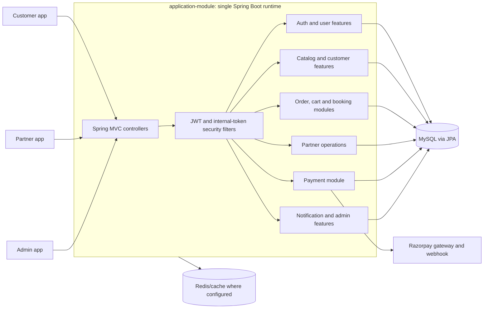

# Lexho User Service — Technical Interview Prep (Simple Hinglish)

Yeh guide repository ke actual Maven files aur Java source code ke basis par hai. Isme documented intentions aur implemented code ko alag rakha gaya hai. Yeh code walkthrough hai; tests run nahi kiye gaye.

## 1. Project ka purpose aur business logic

Code ke basis par Lexho ek **service-booking platform backend** hai. Customer services browse karke cart/booking workflows use karta hai; partner apne orders aur operations manage karta hai; admin catalog, users, payments aur operations manage karta hai.

Business areas auth, customer/catalog, cart/booking, partner operations, payments, notifications aur admin mein divided hain. Yeh **modular monolith** hai: Maven modules code ko separate karte hain, lekin `application-module` inhe ek Spring Boot runtime mein load karta hai. Alag independently deployed microservices hona code inspection se establish nahi hota.

## 2. Technology stack aur Maven multi-module architecture

Root POM Java 17 aur Spring Boot 3.5.11 set karta hai. Maven reactor ke modules:

| Module | Role |
|---|---|
| `common-lib` | Shared code aur common utilities |
| `auth-service` | Auth token aur refresh-token code |
| `admin-module` | Admin domain entities/repositories |
| `user-service` | User management, JWT security, calls/socket code |
| `order-service` | Cart/order/booking entities, repositories, lifecycle services |
| `payment-service` | Razorpay payments aur webhook handling |
| `partner-module` | Partner domain code |
| `catalog-module` | Service categories/subcategories |
| `notification-module` | Notification, preference, template aur log domain |
| `application-module` | Modules ko jodne wala single runnable Spring Boot app |
| `coverage-report` | JaCoCo aggregate report configuration |

Stack mein Spring MVC, Spring Security, Spring Data JPA, MySQL, Flyway, Redis/cache, OpenFeign, WebSocket, Actuator/Micrometer, springdoc OpenAPI aur Razorpay Java SDK shamil hain. RabbitMQ, Firebase aur Resilience4j dependencies bhi configured hain; dependency ka hona har feature ke active use ka proof nahi hai.

- [Root pom.xml](pom.xml)
- [application-module/pom.xml](application-module/pom.xml)

## 3. Folder structure aur important Java classes

- `application-module/src/main/java/com/lexho/user_service/` — combined app ke feature packages: `lexho`, `customer`, `booking`, `payment`, `lexhopartner`, `admin`, `notification`, `security`, `config`, `exception`.
- `user-service/src/main/java/com/lexho/user/` — user management, JWT/security, call aur socket components.
- `order-service/src/main/java/com/lexho/booking/` — booking/order/cart entities, repositories aur lifecycle services.
- `payment-service/src/main/java/com/lexho/payment/` — payment controllers/services, Razorpay gateway aur webhook processing.
- `auth-service/src/main/java/com/lexho/auth/` — JWT aur refresh-token services.
- `*/src/main/resources/db/migration/` — Flyway SQL migrations.
- `*/src/test/` — unit aur integration test source files.

Interview ke liye useful classes:

- Startup/scanning: [UserServiceApplication.java](application-module/src/main/java/com/lexho/user_service/UserServiceApplication.java)
- OTP auth: [LexhoAuthService.java](application-module/src/main/java/com/lexho/user_service/lexho/service/LexhoAuthService.java)
- Authorization config: [SecurityConfig.java](application-module/src/main/java/com/lexho/user_service/config/SecurityConfig.java)
- JWT request filter: [JwtFilter.java](application-module/src/main/java/com/lexho/user_service/config/JwtFilter.java)
- Booking lifecycle: [OrderLifecycleService.java](order-service/src/main/java/com/lexho/booking/service/OrderLifecycleService.java)
- Payment logic: [PaymentService.java](payment-service/src/main/java/com/lexho/payment/service/PaymentService.java)
- Razorpay webhook: [RazorpayWebhookController.java](payment-service/src/main/java/com/lexho/payment/webhook/RazorpayWebhookController.java)

## 4. Application entry point aur startup flow

Combined runtime ka entry point `application-module` ke `com.lexho.user_service.UserServiceApplication` mein hai. `main()` `SpringApplication.run(...)` call karta hai. Class broad `com.lexho` component scan, JPA entity/repository scan, Feign client scan, scheduling aur caching enable karti hai.

Startup ka overview:

1. Spring Boot application start hoti hai.
2. Component scan se application aur domain-module beans load hote hain.
3. JPA entities/repositories configure hote hain; Flyway migrations properties se configure hoti hain.
4. Security filters aur web routes configure hote hain.
5. Controllers HTTP APIs serve karte hain.

`user-service` module mein bhi `UserServiceApplication` entry point hai. Combined application apne component scan mein legacy `com.lexho.user` ke kuch packages ko explicitly exclude karti hai. Interview mein dono entry points ka farq batana useful hai.

Combined app ki configuration: [application.properties](application-module/src/main/resources/application.properties). Ismein port `8082`, environment-overridable database settings, aur Flyway locations configured hain.

## 5. Controllers, services, repositories, APIs aur database

Typical request flow:

`Controller → Service → Repository → JPA Entity → Database`

- **Controller:** HTTP route, request/response DTO aur status code.
- **Service:** business rules, validation aur transactional workflow.
- **Repository:** Spring Data JPA CRUD aur custom queries.
- **Entity:** database mein persist hone wala model.
- **DTO:** API contract ko entity se separate rakhta hai.

Source examples:

- Customer service/catalog/cart routes: [CustomerServiceController.java](application-module/src/main/java/com/lexho/user_service/customer/controller/CustomerServiceController.java), [CustomerCartFallbackController.java](application-module/src/main/java/com/lexho/user_service/customer/controller/CustomerCartFallbackController.java).
- Booking/order entities aur repositories `order-service` mein hain. Inspected booking controller example admin routes deta hai: [AdminBookingController.java](order-service/src/main/java/com/lexho/booking/controller/AdminBookingController.java).
- Payment endpoints `/api/payments` aur `/api/v1/payments` ke neeche create-order, retry, verify aur status operations expose karte hain: [PaymentController.java](payment-service/src/main/java/com/lexho/payment/controller/PaymentController.java).
- Database schema migrations Flyway se version hoti hain; application properties `application-module` aur `user-service` migration locations configure karti hain.

**Boundary:** yahan inspected `order-service` controller list mein admin booking controller mila. Customer booking endpoints ka complete route map is walkthrough mein confirm nahi hua, isliye unhe assumed implementation ke roop mein present nahi kiya gaya.

## 6. Authentication, security aur exception handling

Combined app ka [SecurityConfig.java](application-module/src/main/java/com/lexho/user_service/config/SecurityConfig.java) stateless sessions, CSRF/CORS, security headers aur JWT/internal-token filters configure karta hai. Kuch health, OTP/login, public content/catalog aur webhook routes permit hain. Customer, partner aur admin routes role ke basis par protected hain. Method-level `@PreAuthorize` checks bhi controllers par milte hain.

OTP auth ka [LexhoAuthService.java](application-module/src/main/java/com/lexho/user_service/lexho/service/LexhoAuthService.java) flow:

1. Requested role validate hota hai; customer/partner supported hain.
2. OTP challenge create hota hai; OTP hash, expiry aur attempt count store hote hain.
3. Verification par challenge check/consume hota hai aur user profile retrieve ya create hoti hai.
4. Access JWT generate hota hai; refresh token ka hash database mein save hota hai.
5. Refresh aur logout methods token lifecycle handle karte hain.

Request filtering [JwtFilter.java](application-module/src/main/java/com/lexho/user_service/config/JwtFilter.java) mein hai. Global aur domain-specific exception handlers maujood hain. [GlobalExceptionHandler.java](application-module/src/main/java/com/lexho/user_service/exception/GlobalExceptionHandler.java) validation/conflict/unexpected errors ko API responses mein map karta hai; unexpected error ka client-facing message generic hai.

**Config note:** source properties mein local/dev fallback JWT secret hai. Production secret ko environment/config se supply karna chahiye; repo ka fallback production-safe kehna sahi nahi hoga.

## 7. Code-based business flows

### OTP login

`sendOtp(mobile, role)` existing challenge check karke resend wait, expiry aur attempts enforce karta hai, phir hashed OTP challenge persist karta hai. `verifyOtp(...)` OTP compare karta hai, challenge consume karta hai, profile create/retrieve karta hai, access JWT issue karta hai aur refresh token digest save karta hai. Implementation: [LexhoAuthService.java](application-module/src/main/java/com/lexho/user_service/lexho/service/LexhoAuthService.java).

### Payment

Payment controller create-order/retry/verify/status requests ko `PaymentService` deta hai. Razorpay webhook ke liye alag controller/endpoint hai. Sources: [PaymentController.java](payment-service/src/main/java/com/lexho/payment/controller/PaymentController.java), [PaymentService.java](payment-service/src/main/java/com/lexho/payment/service/PaymentService.java), [RazorpayWebhookController.java](payment-service/src/main/java/com/lexho/payment/webhook/RazorpayWebhookController.java).

Webhook implementation ka hona code se confirmed hai; successful production gateway connectivity ya credentials is inspection se establish nahi hote.

### Partner operations

Partner controllers/services order actions, operational status/profile, catalog aur settlement areas cover karte hain. Examples: [LexhoPartnerOrderController.java](application-module/src/main/java/com/lexho/user_service/lexhopartner/controller/LexhoPartnerOrderController.java), [PartnerOrderService.java](application-module/src/main/java/com/lexho/user_service/lexhopartner/service/PartnerOrderService.java). Role checks security config aur method-level annotations dono mein dikhte hain.

### Calls aur realtime

Separate `user-service` module mein call services, timeout scheduler, rate limiting aur socket components hain. In components ka source hona confirmed hai; Redis/socket infrastructure har environment mein configured hai, yeh bina runtime config verify kiye assume nahi karna chahiye.

## 8. Architecture diagram

## 9. Interview questions with code-based answers

**Q1. Kya yeh microservices architecture hai?**  
**A.** Maven modules domain boundaries banate hain, lekin `application-module` in modules ko ek Spring Boot runtime mein include karta hai. Code ke basis par ise modular monolith kehna zyada accurate hai; independent deployments establish nahi hote.

**Q2. `application-module` ka role kya hai?**  
**A.** Yeh business modules ko assemble karke single application run karta hai. Business code domain modules mein organized rehta hai.

**Q3. OTP ko kaise store/verify karte hain?**  
**A.** OTP ka encoded hash challenge record mein store hota hai. Expiry, attempts aur consumed state track hote hain. Verify ke baad JWT issue hota hai aur refresh token ka hash persist hota hai.

**Q4. Request authorization kaise hota hai?**  
**A.** JWT filter token parse karke authentication context set karta hai. Stateless security config routes ko user roles ke basis par protect karti hai.

**Q5. Payment webhook alag kyun hai?**  
**A.** Payment API user-initiated actions (create/verify) leti hai; webhook provider-originated events receive karta hai. Webhook controller signature/event handling path provide karta hai. Idempotency ke specific guarantees batane se pehle service implementation verify karni chahiye.

**Q6. Repository kya karta hai?**  
**A.** Repository JPA ke through entity persistence aur queries karta hai; service business rules aur transactions manage karti hai. Isse HTTP, business aur persistence concerns alag rehte hain.

**Q7. Error response kaise banta hai?**  
**A.** Global aur feature-specific exception handlers exceptions ko API response/status mein map karte hain. Unexpected failures ke liye generic message diya jata hai.

**Q8. Is architecture ki ek important nuance kya hai?**  
**A.** `application-module` combined runtime hai, aur `user-service` mein ek separate application entry-point class bhi hai. Combined app component scanning mein legacy user packages exclude karta hai; dono ko confuse nahi karna chahiye.

## 10. One-minute interview summary

“Lexho Java 17 aur Spring Boot par bana modular monolith backend hai. `application-module` single runtime assemble karta hai; auth, user, catalog, order/booking, partner, payment, notification aur admin code alag Maven modules/packages mein organized hai. REST APIs Spring MVC se serve hoti hain, persistence Spring Data JPA/MySQL/Flyway par based hai, aur stateless JWT role-based security use hoti hai. OTP auth, payment endpoints/webhook aur partner workflows source code mein implemented hain. Main ise microservices nahi kahunga jab tak independent runtime deployments ka evidence na ho.”
